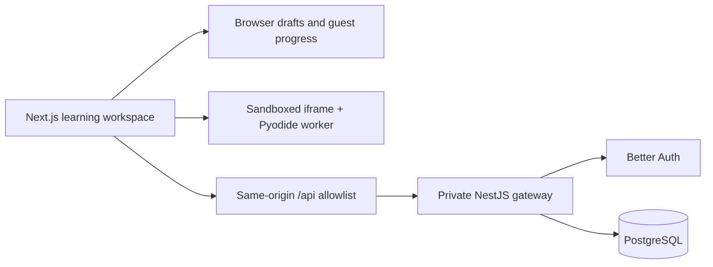

# Architecture and data

## Implemented request paths

- The browser runner has no application-service capability. It is ephemeral, uses a restrictive CSP, and has load/execution deadlines.
- The Next.js account proxy accepts only `account/status`, a named set of Better Auth endpoints, and `graphql`. It forwards to one server-configured `GATEWAY_URL`; clients cannot supply an upstream URL.
- The gateway derives the account owner from a verified session. It never accepts a browser-supplied owner ID.
- PostgreSQL is authoritative for account state. The gateway is the only application component allowed to access it.

## Data rules

| Data | Owner | Important invariant |
| --- | --- | --- |
| Guest progress, editor drafts, notebooks | Browser storage | Untrusted convenience data; loss must not grant authority. |
| Users, sessions, verification | Better Auth + PostgreSQL | Credentials are hashed; sessions can be revoked. |
| Progress | Gateway + PostgreSQL | Unique user/lab row, immutable lab version, optimistic revision. |
| Guest import | Gateway + PostgreSQL | Idempotency key and payload hash prevent duplicate imports. |
| Admission buckets | Gateway + PostgreSQL | HMAC-derived keys and atomic updates; no client-provided identity. |

## Target architecture, only when needed

The production platform can later add a private Go execution service, disposable isolated workers, a Socratic tutor service, a transactional outbox/RabbitMQ, Valkey-based global budgets, and organizations. Each requires a contract before integration:

- GraphQL for browser-to-gateway operations.
- Protobuf/gRPC for private runner/tutor operations.
- A transactional outbox for events; never dual-write PostgreSQL and a queue.
- At-least-once processing with event IDs and consumer deduplication; never claim exactly-once delivery.
- Immutable lab/prompt versions so attempts remain explainable after content updates.

## Non-negotiable boundaries

Untrusted learner code cannot touch databases, internal services, secrets, or the network. AI and remote judges are untrusted external dependencies with deadlines, budgets, schema validation, observability, and deterministic fallback. Tenant membership and permissions must be enforced in the gateway, never by a hidden UI control or a supplied organization ID.
